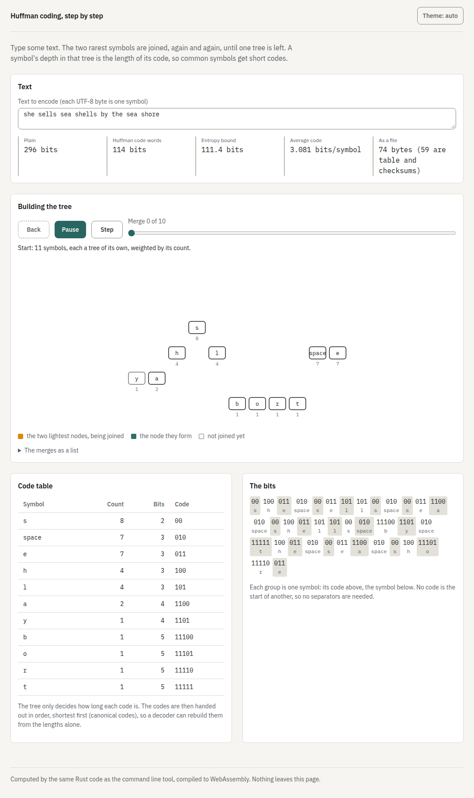

<p align="center"></p>

# Huffman

Huffman file compressor in Rust with CRC-32 checks and a web page that shows the code tree being built.

[Live demo](https://varunagarwalofficial.github.io/huffman/) · [MIT licence](LICENSE)

It compresses and decompresses files of any size in a few megabytes of
memory, checks what it reads with CRC-32, and can show the code it built:
the table of symbols, the tree, and how close the result is to the entropy
bound. A small browser page builds the tree step by step for typed text.



## Results

- **A 1 GiB file in 3.9 s to encode and 3.3 s to decode, in 4.7 MiB of memory.** The first
  version needed 644 MiB for a quarter of that.
- **At most one bit a symbol above the entropy**, as the theory guarantees, and `inspect` shows
  the gap for any input.
- **Every block is checked with CRC-32** before it is written, so a damaged file never produces
  wrong bytes.
- Measured honestly against gzip on the Canterbury corpus: gzip makes files 1.6 to 2.2 times
  smaller, and this coder encodes faster ([table](#compared-with-gzip)).

**Stack:** Rust with no dependencies, a command line with shell completions; the same library
compiled to WebAssembly for a plain JavaScript page.

## The idea

This started as a data structures course project at university. The lecture
proved that a greedy rule (always merge the two rarest symbols) gives the
best possible prefix code, and the project turned that proof into a program
that actually made a file smaller. It was written twice: first in C, with an
encoder, a decoder and a small menu, and a year later in Python, as a
shorter encoder that wrote the code table to a JSON file next to the bits.
This version keeps the idea and rebuilds the rest: one library, one command
line tool, any bytes rather than only text, files larger than memory, and a
decoder that checks what it reads.

## How it works

**Greedy merge.** Count how often each byte value occurs. Put every used
byte into a min-heap as a one-leaf tree weighted by its count. Take out the
two lightest trees, join them under a new node whose weight is their sum, put
that back, and repeat until one tree is left. The depth of a leaf is the
length of its code. Ties are broken by a fixed rule (leaves before merged
nodes, then lower byte value, then older node), so the same input always
gives the same code.

**Why it is optimal.** By an exchange argument: in any optimal tree the two
rarest symbols can be swapped into the two deepest sibling positions without
increasing the cost, so some optimal tree has them as siblings. Treating that
pair as one symbol leaves a smaller problem of the same kind, and induction
does the rest. The tests check the textbook frequencies
45, 13, 12, 16, 9, 5, which must cost 224 bits.

**Canonical codes.** Many trees share the same code lengths. Sort the symbols
by (length, byte value) and hand out consecutive binary numbers, appending
zeros when the length grows. Both sides can rebuild this code from the
lengths alone, so the file stores one length per used symbol instead of a
tree, and the decoder needs only a small table per code length.

**Edge cases.** An empty input has no symbols and no blocks: the container
is the 5-byte header and the 17-byte end marker. An input with one distinct
byte gets a one-bit code, so every symbol still costs a bit. Codes longer
than 48 bits cannot occur in a 1 MiB block (a tree that deep needs billions
of symbols); the length limit exists for the library interface, and when it
applies the counts are halved and the tree rebuilt until it fits, which stays
a valid prefix code but is no longer strictly optimal.

**File format, version 2.** All integers are little endian.

| Part       | Size | Field                                              |
|------------|------|----------------------------------------------------|
| header     | 4    | magic bytes `HUFF`                                 |
|            | 1    | format version, currently 2                        |
| data block | 1    | block type `0x01`                                  |
|            | 4    | original length of the block, 1 to 1,048,576 bytes |
|            | 4    | CRC-32 of the block's original bytes               |
|            | 2    | number of used symbols n, 1 to 256                 |
|            | 2n   | n pairs of (byte value, code length), ascending    |
|            | 4    | payload length p in bytes                          |
|            | p    | code words, most significant bit first, zero padded |
| end marker | 1    | block type `0x00`                                  |
|            | 8    | total original length                              |
|            | 4    | number of data blocks                              |
|            | 4    | CRC-32 over the stored block CRCs, in order        |

**Streaming.** The input is cut into blocks of 1 MiB. Each block has its own
code table, so encoder and decoder hold one block at a time and work on
pipes. Measured on a 1 GiB file of base64 text (peak resident memory read
from `/proc/<pid>/status`): encode 3.9 s at 4.7 MiB, decode 3.3 s at 4.7 MiB.
The first version of this program needed 644 MiB to encode a quarter of that.
The price is one table per block (at most 527 bytes per MiB) and a code that
adapts per block rather than to the whole file.

**Integrity.** A block is decoded, checked against its CRC-32, and only then
written, so the output never contains bytes that failed the check. The end
marker catches a file cut between blocks and blocks that were dropped,
repeated or reordered. Errors say what is wrong: bad magic, unsupported
version (version 1 files get a message of their own), truncated container,
invalid table, checksum mismatch with the block number, end marker mismatch,
trailing data. When decoding to a file, the output is written under a
temporary name and renamed at the end, so a failed run leaves nothing behind.
When decoding to a pipe, the blocks before the damaged one have already been
sent. CRC-32 detects accidents, not tampering.

**Entropy bound.** For symbol probabilities p, the Shannon entropy
H = -sum(p * log2(p)) is a lower bound on the average code length of any
prefix code, and with two or more distinct symbols a Huffman code is within
one bit of it: H <= average < H + 1. (A single distinct byte has H = 0 but
still costs one bit per symbol.) `inspect` prints both numbers. The gap comes from code
lengths being whole bits, and it is largest when one symbol dominates.

## Compared with gzip

`scripts/bench.sh` downloads the Canterbury corpus into `bench/` (not
committed), checks every round trip, and prints this table. Ratios are
compressed size over original size, so smaller is better. Times are the best
of five runs in milliseconds, process start included.

| File | Bytes | huffman | gzip -6 | gzip -9 | huffman ratio | gzip -6 ratio | huffman enc/dec ms | gzip -6 enc/dec ms |
|---|---:|---:|---:|---:|---:|---:|---:|---:|
| alice29.txt | 152089 | 87873 | 54435 | 54191 | 0.578 | 0.358 | 1 / 1 | 7 / 1 |
| lcet10.txt | 426754 | 250770 | 144885 | 144429 | 0.588 | 0.340 | 3 / 2 | 19 / 2 |
| kennedy.xls | 1029744 | 463081 | 206779 | 209733 | 0.450 | 0.201 | 5 / 4 | 21 / 2 |
| ptt5 | 513216 | 106906 | 56443 | 52382 | 0.208 | 0.110 | 3 / 2 | 8 / 1 |
| sum | 38240 | 26192 | 12924 | 12772 | 0.685 | 0.338 | 1 / 1 | 2 / 0 |
| random.bin | 1048576 | 1049125 | 1048765 | 1048765 | 1.001 | 1.000 | 4 / 4 | 18 / 2 |

gzip wins on size on every real file, by a factor of about 1.6 to 2.2. That
is expected: this program codes each byte on its own from its frequency, and
gzip first replaces repeated strings with back-references (LZ77) and then
Huffman-codes the result. Nothing here sees that "the" follows a space.
Huffman alone encodes faster, and that is the only thing it wins. `random.bin`
is 1 MiB from `/dev/urandom`: neither tool can shrink it.

## Run it

Needs a Rust toolchain (1.88 or newer).

```
cargo build --release

target/release/huffman encode samples/lighthouse.txt /tmp/lighthouse.huf
target/release/huffman decode /tmp/lighthouse.huf /tmp/lighthouse.txt
cmp samples/lighthouse.txt /tmp/lighthouse.txt

tar c src | target/release/huffman encode -v > /tmp/src.tar.huf
target/release/huffman inspect samples/lighthouse.txt
target/release/huffman --help
```

File names default to `-`, standard input and output. `huffman help encode`
(or `decode`, `inspect`, `completions`) explains one command. Shell
completions for bash, zsh and fish:

```
source <(target/release/huffman completions bash)
```

The bash and fish scripts were loaded and tried here; the zsh one was not,
because zsh is not installed on the machine this was written on.

```
printf 'abracadabra' | target/release/huffman inspect
```

```
symbol byte      count   share bits  code
------ ---- ---------- ------- ----  ----
'a'    0x61          5  45.45%    1  0
'b'    0x62          2  18.18%    3  100
'r'    0x72          2  18.18%    3  111
'c'    0x63          1   9.09%    3  101
'd'    0x64          1   9.09%    3  110

tree (branch labels are code bits, numbers are weights)
(11)
+-0- 'a' 5
`-1- (6)
     +-0- (3)
     |    +-0- 'b' 2
     |    `-1- 'c' 1
     `-1- (3)
          +-0- 'd' 1
          `-1- 'r' 2

input bytes     11
output bytes    50 (47 headers, tables and checksums; 3 code words; 1 block)
ratio           4.545 (output / input, +354.5% size change)
distinct bytes  5
entropy         2.0404 bits/symbol
average code    2.0909 bits/symbol (+0.0505 above entropy)
```

Small inputs grow, because headers, table and checksums cost more than the
payload saves. With more than 24 distinct bytes the tree is listed by depth
instead of drawn. `inspect` takes an uncompressed file; its table is one code
for the whole input, while the container codes each 1 MiB block on its own.
Exit status is 0 on success, 1 for a file that cannot be read, written or
decoded, 2 for a wrong command line.

## Demo page

`web/` is a static page: type text, step through the merges, see the code
table and the bits. The numbers come from this library compiled to
WebAssembly (`wasm/`, a plain C interface, no wasm-bindgen). The built
`web/huffman.wasm` is committed, so serving the folder is enough:

```
python3 -m http.server 8000 --bind 127.0.0.1 -d web
```

To rebuild the module after changing the library:

```
cargo build --release -p huffman-wasm --target wasm32-unknown-unknown
cp target/wasm32-unknown-unknown/release/huffman_wasm.wasm web/huffman.wasm
```

### The look

The page uses the owner's site look, "Editorial". `web/c-editorial-tokens.css`
is copied unchanged from the website, and `web/base.css` (the same file in
huffman, quantum-key-exchange and fog-scheduling) maps the page's own
variables onto it: page and ink in light and dark (following the system), the
oxblood accent for links and focus only, Newsreader for text and the tree's
labels, IBM Plex Mono for code, CM Web Serif for mathematics, the site's
sizes (17, 20, 22 and 28 px, and the title), spacing, measure, rules and focus
ring. The token file asks for its fonts at `/fonts/`, so serve `web/` as the
site root (as above) or from the website. The Pages workflow
rewrites them to `fonts/` in the copy it publishes. The fonts and their licences
(`Newsreader-OFL.txt`, `IBM-Plex-OFL.txt`, `GUST-FONT-LICENSE.txt`,
`LPPL-1.3c.txt`, `NewCM-License.txt`) are in `web/fonts/`.

Sections are set off by space and a rule, with no boxes, fills or shadows.
Play is the only filled control. Meaning colours, the same in all six tools:

| Role in the code | Meaning here                      | Site token             |
| ---------------- | --------------------------------- | ---------------------- |
| compare          | the two rarest, being joined now  | `--site-mean-measured` |
| accent           | the join they form                | `--site-mean-open`     |
| change           | (written, moved or wrong; unused) | `--site-mean-against`  |
| good             | (finished or kept; unused)        | `--site-mean-proved`   |

Removed in the restyle: IBM Plex Sans, the old teal palette and its six
series colours, the unused `theme.js`, panel boxes and fills, rounded corners,
the drawn select arrow, transitions and the brightness change on hover. What
the new typeface moved: tree labels are 17 px instead of 13 and 11, so each
leaf's column is at least as wide as its label ("space" gets a wider column
than "e"), rows are at least 46 px apart, and joins are a little larger. The
bits, codes and totals are set in the text face with lining figures instead of
the monospace.

## Test

```
cargo fmt --all --check
cargo clippy --workspace --all-targets -- -D warnings
cargo test --workspace
npx @biomejs/biome@2.6.7 check
```

A few unit tests sit next to the modules in `src/`; `tests/roundtrip.rs`
covers the library end to end and `tests/cli.rs` runs the built binary.

## Layout

```
src/freq.rs       byte counts and entropy
src/tree.rs       greedy merge on a binary heap, code lengths, length limit
src/canonical.rs  canonical code assignment and decoding
src/bits.rs       bit writer
src/crc.rs        CRC-32
src/container.rs  file format, streaming encode and decode
src/report.rs     text for inspect: table, tree, summary
src/main.rs       command line
src/completions.rs  shell completion scripts
wasm/             C interface for the demo page
web/              the demo page; base.css and the tokens give it the site's look
scripts/bench.sh  comparison with gzip
```

## Credit

Based on a VIT group course project for CSE2003 Data Structures and Algorithms: a C version
in 2020 and a Python rewrite, [CSE2003-Huffman-Coding](https://github.com/VarunAgarwalOfficial/CSE2003-Huffman-Coding).

## Status

Working, as of 26 November 2026. See [STATUS.md](STATUS.md).

## Licence

MIT. See [LICENSE](LICENSE).
